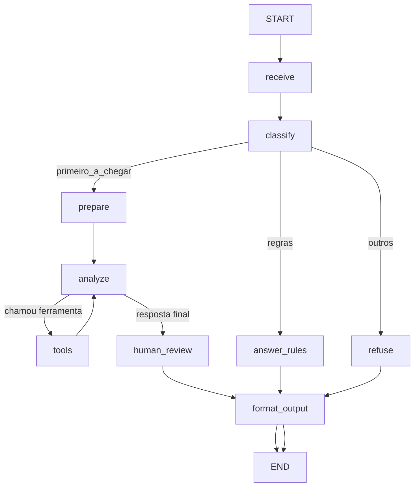
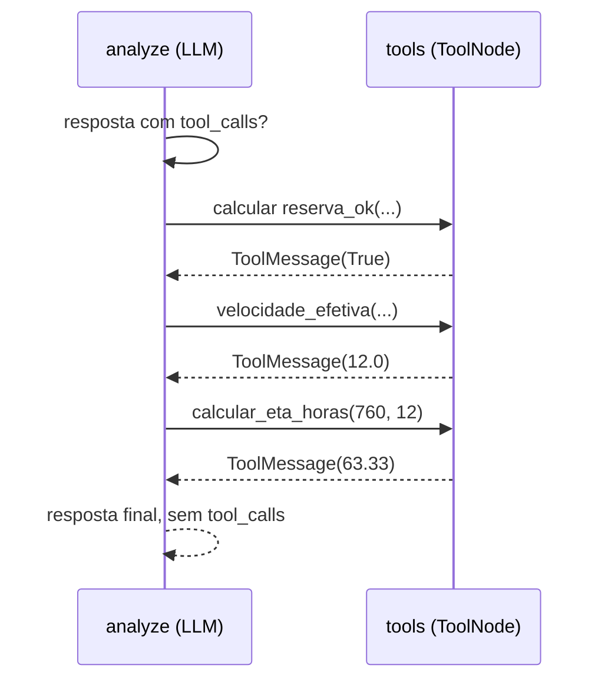

# Guia de Estudos: Despachante do Porto (LangGraph + LangChain)

Este guia explica o projeto **de dentro para fora**: primeiro o problema, depois a configuração, o grafo, os padrões e, por fim, exercícios para você mexer no código. Cada tópico aponta para o arquivo real onde o conceito aparece.

---

## 1. Visão Geral e Arquitetura do Projeto

### 1.1 Problema que a aplicação resolve

Uma frota de navios sai do **Porto Alfa** rumo a portos diferentes. O operador faz perguntas em linguagem natural, por exemplo:

- "Qual navio chega primeiro ao porto?"
- "Qual é a regra de cálculo do ETA?"
- "Qual a capital do Brasil?"

O sistema decide **o que fazer com cada pergunta**, calcula o que for necessário com código (e não "de cabeça" pelo LLM) e, para a recomendação de chegada, **pede aprovação de um humano** antes de entregar a resposta final.

A regra de negócio central é:

```text
ETA (horas) = distância (milhas náuticas) / velocidade efetiva (nós)
```

Quem tem o **menor ETA** chega primeiro. Em tempestade, a velocidade efetiva é limitada a 12 nós. Navios com combustível abaixo da reserva **não podem zarpar** e ficam fora da comparação.

### 1.2 Fluxo de execução em alto nível



Este diagrama reflete as arestas de [src/graph/builder.py](../src/graph/builder.py). Em resumo:

1. **receive** carrega os dados da frota de [src/app/dados/frota_tempestade.json](../src/app/dados/frota_tempestade.json).
2. **classify** usa o LLM com saída estruturada para decidir a intenção da pergunta.
3. Conforme a intenção, o fluxo segue para o cálculo de chegada, para as regras do sistema ou para a recusa.
4. No cálculo de chegada, **analyze** conversa com o modelo, que pode pedir ferramentas (**tools**). O ciclo `analyze ⇄ tools` se repete até o modelo parar de pedir ferramentas.
5. **human_review** pausa o grafo com `interrupt`. O usuário responde `s` ou `n` no terminal.
6. **format_output** monta o texto final.

### 1.3 Estrutura de pastas

```text
deloitte-agentic-ai-bootcamp/
├── docs/                    # Enunciados dos exercícios (você está aqui)
├── src/
│   ├── app/
│   │   ├── app.py           # Ponto de entrada (CLI): pergunta, executa o grafo, pede aprovação
│   │   └── dados/           # JSONs da frota (simples e com tempestade)
│   ├── graph/
│   │   ├── builder.py       # Monta e compila o grafo
│   │   ├── state.py         # Estado compartilhado entre os nós
│   │   ├── routing.py       # Função de roteamento (aresta condicional)
│   │   ├── tools.py         # Ferramentas que o LLM pode chamar
│   │   ├── nodes/           # Um diretório por nó
│   │   └── prompts/         # Templates de prompt
│   └── utils/
│       ├── llm_adapter.py   # get_llm(): cria o modelo a partir do .env
│       └── langfuse_client.py  # Tracing opcional com Langfuse
├── .env.example             # Modelo das variáveis de ambiente
├── requirements.txt         # Dependências com versões fixadas
└── README.md
```

Não versionados (ver [.gitignore](../.gitignore)): `.env` (suas chaves) e `.venv/` (ambiente virtual). A pasta `week-01/` contém apenas arquivos `.pyc` de uma versão antiga, sem código-fonte. Ignore-a ao estudar.

---

## 2. Stack Tecnológica e Dependências

As versões abaixo vêm de [requirements.txt](../requirements.txt).

| Pacote | Versão | Papel no projeto | Onde aparece |
|---|---|---|---|
| `langgraph` | 1.2.19 | Orquestra o fluxo como **grafo de estados**: nós, arestas, ciclos, checkpointer e `interrupt`. | `builder.py`, `human_review.py`, `app.py` |
| `langchain` | 1.4.9 | Fornece `init_chat_model` (criação genérica de modelos) e a camada de alto nível do ecossistema. | `llm_adapter.py` |
| `langchain-core` | 1.7.5 | Núcleo das abstrações: `ChatPromptTemplate`, `@tool`, mensagens (`AIMessage`, `ToolMessage`). | `prompts/*.py`, `tools.py` |
| `langchain-openai` | 1.7.4 | Integração com a API da OpenAI, usada pelo `init_chat_model` quando `LLM_PROVIDER=openai`. | Indireto, via `llm_adapter.py` |
| `langfuse` | 5.1.0 | Observabilidade: registra cada chamada ao LLM, ferramenta e nó. Opcional. | `langfuse_client.py` |
| `python-dotenv` | 1.2.4 | Carrega o arquivo `.env` para `os.environ`. | `llm_adapter.py` |
| `pydantic` | 2.14.2 | Valida dados. Define o schema da saída estruturada do `classify`. | `classify.py` |

Observações:

- **`langgraph` e `langchain` são coisas diferentes.** O LangGraph controla **o fluxo** (quem executa depois de quem). O LangChain fornece **os blocos** que os nós usam (modelo, prompt, ferramenta).
- Os pacotes de ferramentas de teste (como `pytest`) **não estão** no `requirements.txt`. Os exercícios da seção 4 pedem para instalá-los.
- O README indica Python 3.11+. O `.venv` local foi criado com Python 3.13.

---

## 3. Trilha de Aprendizado Prática

### Módulo 1: Configuração e Fundamentos

**Objetivo:** colocar o projeto para rodar e entender como a configuração chega ao código.

#### 3.1.1 Variáveis de ambiente

O arquivo [.env.example](../.env.example) lista as variáveis. Copie-o para `.env` e preencha.

| Variável | Obrigatória | Para que serve |
|---|:---:|---|
| `LLM_PROVIDER` | Sim | Provedor usado por `init_chat_model` (ex.: `openai`). |
| `LLM_MODEL` | Sim | Nome do modelo (ex.: `gpt-4o-mini`). |
| `OPENAI_API_KEY` | Sim | Chave da API do provedor. |
| `OPENAI_BASE_URL` | Não | Endpoint alternativo compatível com a API da OpenAI. |
| `LANGFUSE_PUBLIC_KEY` / `LANGFUSE_SECRET_KEY` | Não | Ativam o tracing. Sem elas, o tracing fica desligado. |
| `LANGFUSE_HOST` | Não | Host do Langfuse. |

Pontos de atenção:

- O `.env` **nunca** deve ser commitado. O `.gitignore` já ignora `.env` e `*.env`, mantendo apenas o `!.env.example`.
- Não cole chaves reais em código, em prints ou em mensagens de commit.

#### 3.1.2 Criando o LLM: o adaptador

Em [src/utils/llm_adapter.py](../src/utils/llm_adapter.py):

```python
load_dotenv()

def get_llm(temperature: float = 0):
    return init_chat_model(
        model=os.environ["LLM_MODEL"],
        model_provider=os.environ["LLM_PROVIDER"],
        temperature=temperature,
    )
```

Três conceitos:

- **`load_dotenv()`** é executado na importação do módulo. Por isso o `.env` já está carregado quando qualquer nó chama `get_llm()`.
- **`init_chat_model`** cria um modelo de chat sem que o resto do código precise saber qual é o provedor. Trocar de OpenAI para outro provedor exige mudar só o `.env`.
- **`temperature=0`** reduz a aleatoriedade. Isso **não garante** respostas idênticas. Veja o Módulo 3.

Regra do projeto: **nenhum nó importa o provedor diretamente**. Todos chamam `get_llm()`.

#### 3.1.3 Tracing opcional: `run_config`

Em [src/utils/langfuse_client.py](../src/utils/langfuse_client.py):

- `get_langfuse_handler()` devolve `None` se as chaves não existirem. Assim, o projeto roda com ou sem Langfuse.
- `run_config(**extra)` monta o dicionário de configuração do grafo. Se houver handler, ele entra em `callbacks`.
- `flush()` envia os dados pendentes ao final da execução.

Esse padrão (**dependência opcional, degradação silenciosa**) reaparece no Módulo 3.

#### 3.1.4 Inicialização da aplicação

Em [src/app/app.py](../src/app/app.py), a sequência é:

1. `build_graph()` monta e compila o grafo.
2. `input("Pergunta: ")` recebe a pergunta (com um padrão caso a entrada esteja vazia).
3. `graph.invoke({"pergunta": ...}, config=config)` executa o grafo.
4. Se a saída contém `__interrupt__`, o programa mostra a recomendação, pede `s`/`n` e retoma com `Command(resume=...)`.
5. Imprime `saida["resultado"]` e chama `flush()`.

Como executar, na raiz do projeto:

```bash
python -m venv .venv
source .venv/Scripts/activate        # Git Bash no Windows; no PowerShell: .venv\Scripts\Activate.ps1
pip install -r requirements.txt
cp .env.example .env                 # depois preencha as chaves
python -m src.app.app
```

Use `python -m` e não `python src/app/app.py`. Os imports são absolutos a partir de `src.` e só funcionam quando a raiz do projeto está no `sys.path`.

---

### Módulo 2: Fluxos e Lógica Principal

**Objetivo:** entender o estado, os nós e as arestas, e seguir uma pergunta do início ao fim.

#### 3.2.1 Estrutura de dados: o estado

[src/graph/state.py](../src/graph/state.py) define o estado compartilhado:

```python
class State(TypedDict, total=False):
    pergunta: str
    intent: str
    frota: dict
    dados: str
    resposta_llm: str
    resultado: str
    messages: Annotated[list, add_messages]
    recomendacao: str
    aprovado: bool
    nota_operador: str
```

Conceitos-chave:

- **`TypedDict(total=False)`** indica que nenhum campo é obrigatório. Cada nó devolve **só os campos que alterou**, e o LangGraph faz o merge.
- **`Annotated[list, add_messages]`** é um **reducer**. Em vez de substituir a lista, ele **acrescenta** mensagens (e substitui quando o `id` coincide). É isso que permite o ciclo `analyze ⇄ tools` manter o histórico.

#### 3.2.2 Dados da frota: do JSON ao texto do prompt

O caminho dos dados é:

1. **`receive`** ([receive.py](../src/graph/nodes/receive/receive.py)) lê o JSON e coloca o dicionário em `frota`:

   ```json
   { "porto_origem": "Porto Alfa", "navios": [ { "id": "S1-FAROL", "distancia_nm": 700, ... } ] }
   ```

2. **`prepare`** ([prepare.py](../src/graph/nodes/prepare/prepare.py)) transforma cada navio em uma linha de texto e grava em `dados`:

   ```text
   - id: S1-FAROL, destino: Porto Norte, distancia_nm: 700, velocidade_kn: 14, em_tempestade: False, combustivel_t: 30, reserva_t: 33
   ```

O LLM **não recebe o JSON**. Ele recebe essas linhas, montadas por código. Isso controla exatamente o que chega ao modelo.

#### 3.2.3 Os nós

| Nó | Arquivo | Tipo | O que faz | Escreve no estado |
|---|---|---|---|---|
| `receive` | [receive.py](../src/graph/nodes/receive/receive.py) | código | Lê `frota_tempestade.json`. | `frota` |
| `classify` | [classify.py](../src/graph/nodes/classify/classify.py) | LLM (saída estruturada) | Classifica a pergunta em uma das três intenções. | `intent` |
| `prepare` | [prepare.py](../src/graph/nodes/prepare/prepare.py) | código | Converte a frota em texto. | `dados` |
| `analyze` | [analyze.py](../src/graph/nodes/analyze/analyze.py) | LLM com ferramentas | Chama `reserva_ok`, `velocidade_efetiva` e `calcular_eta_horas` e depois compara os ETAs. | `messages` |
| `tools` | `ToolNode(TOOLS)` (do `langgraph.prebuilt`) | pronto do LangGraph | Executa as ferramentas pedidas pelo modelo e devolve `ToolMessage`s. | `messages` |
| `human_review` | [human_review.py](../src/graph/nodes/human_review/human_review.py) | pausa (`interrupt`) | Mostra a recomendação e espera a decisão do operador. | `recomendacao`, `aprovado`, `nota_operador` |
| `answer_rules` | [answer_rules.py](../src/graph/nodes/answer_rules/answer_rules.py) | LLM (sem ferramentas) | Responde dúvidas sobre as regras. | `resposta_llm` |
| `refuse` | [refuse.py](../src/graph/nodes/refuse/refuse.py) | código | Devolve um texto fixo de recusa. | `resposta_llm` |
| `format_output` | [format_output.py](../src/graph/nodes/format_output/format_output.py) | código | Monta o texto final em três casos (aprovado, rejeitado, resposta direta). | `resultado` |

#### 3.2.4 Roteamento: as arestas condicionais

Em [src/graph/builder.py](../src/graph/builder.py) existem três tipos de aresta:

- **Aresta fixa:** `graph.add_edge("receive", "classify")`. Sempre segue.
- **Aresta condicional por intenção:** `route_by_intent` ([routing.py](../src/graph/routing.py)) devolve `state["intent"]`. O dicionário mapeia cada valor para um nó.
- **Aresta condicional de ferramentas:** `tools_condition` (do `langgraph.prebuilt`). Se a última mensagem do modelo tem `tool_calls`, vai para `tools`. Senão, vai para `END`, e aqui `END` foi mapeado para `human_review`.

O ciclo de ferramentas:



Cada volta do ciclo passa pelo `add_messages`. Por isso `analyze` consegue ver o histórico completo. Em [analyze.py](../src/graph/nodes/analyze/analyze.py), a primeira chamada envia o prompt e as chamadas seguintes enviam `state["messages"]`.

#### 3.2.5 Ferramentas

Em [src/graph/tools.py](../src/graph/tools.py):

```python
@tool
def velocidade_efetiva(velocidade_kn: float, em_tempestade: bool) -> float:
    """Velocidade efetiva do navio. Em tempestade o limite é de 12 nós."""
    return min(velocidade_kn, LIMITE_TEMPESTADE_KN) if em_tempestade else velocidade_kn
```

O `@tool` transforma a função em algo que o modelo pode chamar. O LLM vê três coisas: **o nome**, **a docstring** e **os tipos dos parâmetros**. A docstring é, na prática, **o contrato que o modelo lê**. Uma docstring vaga leva a chamadas erradas.

As três ferramentas estão em `TOOLS`, e o `analyze` as registra com `get_llm().bind_tools(TOOLS)`.

#### 3.2.6 Human-in-the-loop: pausar e retomar

O grafo pausa em [human_review.py](../src/graph/nodes/human_review/human_review.py):

```python
decisao = interrupt({"recomendacao": recomendacao, "pergunta": "Aprovar a recomendação?"})
```

Para isso funcionar, três peças trabalham juntas:

1. **Checkpointer:** `graph.compile(checkpointer=MemorySaver())` em `builder.py` guarda o estado. Sem ele, não há como retomar.
2. **`thread_id`:** em `app.py`, `configurable={"thread_id": "semana-1"}` identifica a conversa que está sendo retomada.
3. **`Command(resume=...)`:** `app.py` chama `graph.invoke(Command(resume={...}), config=config)`. O valor volta como retorno do `interrupt(...)`.

Ponto sutil: na retomada, **o nó inteiro roda de novo desde o começo**. Por isso nada antes do `interrupt` pode ter efeito colateral. O próprio comentário em `human_review.py` alerta para isso.

#### 3.2.7 Saída final

`format_output` trata três casos:

- `"aprovado" in state`: veio do `human_review`. Retorna "APROVADO" ou "REJEITADO", com a nota se houver.
- `resposta_llm` preenchido: veio de `answer_rules` ou `refuse`.
- Caso contrário: usa a última mensagem (`messages[-1]`) como resposta.

#### 3.2.8 Exemplo de ponta a ponta (dados de tempestade)

Pergunta: "Qual navio chega primeiro ao porto?"

| Navio | Reserva OK? | Velocidade efetiva | ETA (h) | Situação |
|---|:---:|---:|---:|---|
| S1-FAROL | Não (30 < 33) | 14 | — | Não zarpa; fora da comparação |
| S2-MARE | Sim (100 ≥ 42) | 12 (tempestade) | 63,33 | Concorre |
| S3-CORAL | Sim (115 ≥ 51) | 12 | **56,67** | **Chega primeiro** |
| S4-ATLAS | Sim (145 ≥ 60) | 12 (tempestade) | 68,33 | Concorre |

Esses valores são os que as ferramentas devem devolver. Use-os para conferir se o modelo fez as contas corretamente. Se a recomendação divergir, o problema está no ciclo de ferramentas ou no prompt, não na aritmética.

---

### Módulo 3: Padrões e Boas Práticas

**Objetivo:** reconhecer as decisões de projeto que tornam o sistema confiável, e os pontos onde ele ainda é frágil.

#### 3.3.1 Determinismo na roteirização: saída estruturada

Em [classify.py](../src/graph/nodes/classify/classify.py):

```python
class Intencao(BaseModel):
    intent: Literal["primeiro_a_chegar", "regras", "outros"] = Field(...)

structured_llm = llm.with_structured_output(Intencao)
```

Em vez de pedir ao modelo um texto livre do tipo "acho que é sobre regras", o código força uma saída **que só pode ser um dos três valores**. O roteamento depois é uma consulta a um dicionário, sem interpretação de texto. Essa é a base do determinismo do fluxo: **o LLM decide a categoria, mas o caminho é código**.

Observe o `hasattr(resultado, "intent")` no fim do nó. Ele aceita tanto objeto quanto dicionário, dependendo da versão do LangChain.

#### 3.3.2 "LLM não é calculadora"

O prompt em [analyze_prompt.py](../src/graph/prompts/analyze_prompt.py) diz: "NUNCA calcule reserva, velocidade efetiva ou ETA de cabeça". Toda conta passa por uma ferramenta. Isso separa:

- **Raciocínio** (o LLM decide o que calcular, em que ordem e o que comparar);
- **Aritmética** (o código calcula, de forma exata e reproduzível).

Esse é o principal aprendizado do exercício 1 ("Para pensar", item 2). Os erros de conta do modelo são o motivo para existir o `tools.py`.

#### 3.3.3 Tratamento de erros: o que existe e o que falta

O que o projeto faz:

- **Validação na saída do LLM:** o Pydantic restringe o `intent` aos três valores.
- **Recusa explícita:** o nó `refuse` trata perguntas fora do escopo, sem chamar o LLM.
- **Dependência opcional:** sem as chaves do Langfuse, o tracing é desligado sem erro.

O que falta (bons exercícios de melhoria):

- `os.environ["LLM_MODEL"]` lança `KeyError` se a variável não existir. A mensagem não ajuda quem está começando.
- `receive` lê um caminho fixo. Se o arquivo não existir ou o JSON estiver inválido, o erro sobe sem contexto.
- Nenhum nó trata falhas de rede ou de API do LLM.
- Nenhum nó valida se `navios` existe ou se os campos numéricos estão presentes. `prepare` aceita `None` e o modelo recebe "None" como dado.

#### 3.3.4 Determinismo na execução

- `temperature=0` ajuda, mas **não garante** a mesma resposta a cada execução.
- Os valores de referência (ETA 56,67 h etc.) vêm das ferramentas, que são determinísticas. Já o texto da resposta pode variar.
- Para testar o fluxo sem depender do LLM, o caminho recomendado é substituir `get_llm` por um modelo falso (veja o exercício 2).

#### 3.3.5 Modularização

Pontos fortes:

- **Um nó, um diretório, um arquivo.** Facilita localizar e testar.
- **Prompts separados dos nós.** Os textos ficam em `prompts/`, e os nós só montam a chamada.
- **Nós devolvem só o que mudou.** O estado é atualizado por merge, sem que cada nó conheça o estado inteiro.
- **Builder separado.** `builder.py` é o único lugar que define a topologia do grafo.

Pontos a melhorar (código morto e acoplamentos):

| Item | Problema |
|---|---|
| [decide.py](../src/graph/nodes/decide/decide.py) | Nó não registrado no `builder.py`. Também calcula `navios` e não usa. |
| [prompts.py](../src/graph/prompts/prompts.py) | `PROMPT_UMA_LINHA` e `PROMPT_MELHORADO` vêm do exercício 1, sem uso no grafo atual. |
| [answer_rules_prompt.py](../src/graph/prompts/answer_rules_prompt.py) | Apenas reexporta `RULES_PROMPT`. Redundante. |
| [app.py](../src/app/app.py) | Chama `main()` no nível do módulo, sem `if __name__ == "__main__":`. Importar o arquivo já executa o programa. |
| [receive.py](../src/graph/nodes/receive/receive.py) | Caminho do JSON fixo. Trocar a frota exige editar o código. |
| [app.py](../src/app/app.py) | `thread_id="semana-1"` fixo. Duas conversas diferentes compartilhariam o mesmo histórico se o checkpointer fosse persistente. |
| [classify_prompt.py](../src/graph/prompts/classify_prompt.py) vs. enunciado | O enunciado chama a intenção de `fora_escopo`, mas o código usa `outros`. Use `outros` ao escrever testes. |

#### 3.3.6 Dicas de design que valem para qualquer projeto LangGraph

1. **Nós pequenos e puros sempre que possível.** Código de cálculo fica fora do LLM.
2. **Use o estado para comunicação, não variáveis globais.**
3. **Antes de `interrupt`, não faça efeitos colaterais.** O nó roda de novo na retomada.
4. **Docstring de ferramenta é contrato.** Escreva como se ela fosse a documentação oficial.
5. **Teste as partes sem LLM primeiro.** `tools.py` e `routing.py` são funções puras e fáceis de testar.

---

## 4. Desafios Práticos ("Mão na Massa")

Os exercícios são incrementais. Faça na ordem. Crie os arquivos de teste dentro de uma pasta `tests/` na raiz do projeto.

Antes de começar, instale o pytest (ele não está no `requirements.txt`):

```bash
pip install pytest
```

### Desafio 1: testar as ferramentas puras (nível básico)

**Objetivo:** garantir que a aritmética de `src/graph/tools.py` está correta, sem chamar o LLM.

**Passos:**

1. Crie `tests/test_tools.py`.
2. Importe as ferramentas de `src.graph.tools`. Para chamar uma ferramenta `@tool`, use `.invoke({...})`. Exemplo: `calcular_eta_horas.invoke({"distancia_nm": 760, "velocidade_kn": 12})`.
3. Escreva testes para:
   - `calcular_eta_horas`: 760 nm a 12 nós resulta em 63,33.
   - `velocidade_efetiva`: 16 nós em tempestade resulta em 12; 14 nós sem tempestade resulta em 14.
   - `reserva_ok`: 30 t contra reserva de 33 t resulta em `False`; 115 t contra 51 t resulta em `True`.
4. Rode com `python -m pytest tests/ -v`.

**Critério de aceite:** todos os testes passam. Se você mudar `LIMITE_TEMPESTADE_KN` para 10, pelo menos um teste deve falhar.

### Desafio 2: testar o roteamento e o grafo sem LLM real (nível intermediário)

**Objetivo:** testar `route_by_intent` e o fluxo de `format_output` sem gastar tokens e sem depender do modelo.

**Passos:**

1. Crie `tests/test_routing.py` e teste `route_by_intent` com `{"intent": "regras"}`, `{"intent": "outros"}` e `{"intent": "primeiro_a_chegar"}`.
2. Crie `tests/test_format_output.py` com dois casos:
   - Estado com `aprovado=True` e `recomendacao` preenchida: a saída deve começar com "APROVADO pelo operador.".
   - Estado com `resposta_llm` e sem `aprovado`: a saída deve conter "Resposta: ".
3. Crie `tests/test_graph_fake_llm.py`. Use `monkeypatch` para substituir `get_llm` nos módulos que o importam (`src.graph.nodes.classify.classify`, `src.graph.nodes.analyze.analyze`). Use um modelo falso que devolva uma intenção fixa para `classify` e, para `analyze`, uma resposta sem `tool_calls`.

   Dica: procure por "fake" no LangChain (`GenericFakeChatModel` ou `FakeListChatModel` de `langchain_core.language_models.fake_chat_models`). Confirme o nome exato na versão instalada antes de usar.

4. Verifique que a pergunta de "regras" passa por `answer_rules` e não por `prepare`.

**Critério de aceite:** os testes passam sem variável `OPENAI_API_KEY` válida. Para confirmar, rode com `OPENAI_API_KEY=invalida`.

**Atenção:** importe `build_graph` de `src.graph.builder`, e **não** de `src.app.app`. Lembre-se do ponto de atenção da seção 3.3.5 sobre `main()` no nível do módulo.

### Desafio 3: persistir a aprovação entre execuções (nível avançado)

**Objetivo:** hoje o `MemorySaver` guarda o estado só na memória. Se o programa for encerrado no meio da aprovação, a conversa se perde. Substitua o checkpointer por um que grave em disco.

**Passos:**

1. Instale o checkpointer SQLite do LangGraph (`pip install langgraph-checkpoint-sqlite`). Confirme o nome do pacote e a classe na documentação oficial antes de instalar.
2. Adicione a dependência ao `requirements.txt` com a versão instalada, fixada como nos demais pacotes.
3. Em `builder.py`, troque `MemorySaver()` por um checkpointer SQLite apontando para um arquivo como `data/checkpoints.db`. Adicione `data/` ao `.gitignore`.
4. Em `app.py`, troque o `thread_id` fixo `"semana-1"` por um valor passado pelo usuário (por exemplo, pedido com `input("Thread: ")`), com padrão `"semana-1"` se vazio.
5. Teste o fluxo de ponta a ponta:
   - Execute, responda uma pergunta de chegada e **encerre o programa** (Ctrl+C) no prompt "Aprovar? (s/n):".
   - Rode o programa de novo com o mesmo `thread_id`. Com o estado persistido, você deve conseguir retomar a aprovação. Para isso, o `app.py` precisará de um caminho que, ao detectar um checkpoint pendente, pule a pergunta inicial e vá direto à aprovação.

**Critério de aceite:** a retomada funciona após reiniciar o processo, e o `thread_id` diferente inicia uma conversa do zero.

**Pergunta para discussão:** o que muda para a segurança do fluxo se o estado pendente ficar gravado em disco por dias? Quem deveria poder retomar essa aprovação?

---

## 5. Glossário e Conceitos-Chave

| Termo | Definição no contexto do projeto |
|---|---|
| **Grafo de estados** | Modelo de execução em que nós (funções) leem e escrevem num estado compartilhado, e arestas definem a ordem. Base do LangGraph. |
| **Nó** | Função que recebe o estado e devolve um dicionário com os campos que alterou. Ex.: `receive`, `analyze`. |
| **Aresta** | Ligação entre nós. Pode ser fixa (`add_edge`) ou condicional (`add_conditional_edges`). |
| **Aresta condicional** | Aresta cujo destino é escolhido em tempo de execução por uma função. Ex.: `route_by_intent`. |
| **Estado (`State`)** | Estrutura de dados compartilhada entre os nós. Definida como `TypedDict` em `state.py`. |
| **Reducer** | Função que define como um campo é atualizado. `add_messages` acrescenta mensagens em vez de substituir. |
| **Ciclo** | Aresta que volta a um nó anterior. Aqui: `analyze → tools → analyze`. |
| **Checkpointer** | Componente que salva o estado do grafo a cada passo. `MemorySaver` guarda na memória. |
| **`thread_id`** | Identificador de uma conversa dentro do checkpointer. Mesmo `thread_id` retoma o mesmo estado. |
| **`interrupt`** | Pausa o grafo e devolve um valor ao chamador. Na retomada, o nó roda de novo e `interrupt` retorna o valor enviado. |
| **`Command(resume=...)`** | Objeto usado para retomar um grafo pausado, levando a decisão do humano. |
| **Human-in-the-loop** | Padrão em que uma pessoa aprova ou rejeita uma decisão do agente antes de ela ser concluída. |
| **Chat model** | Abstração do LangChain para um modelo de linguagem em formato de conversa. Criado aqui por `init_chat_model`. |
| **`init_chat_model`** | Função que cria um chat model a partir do nome do provedor e do modelo, sem importar a classe específica. |
| **Temperature** | Parâmetro que controla a aleatoriedade da geração. `0` é o mais previsível, mas não garante determinismo total. |
| **Prompt template** | Modelo de prompt com variáveis (`{pergunta}`). Criado com `ChatPromptTemplate`. |
| **Tool calling** | Capacidade do modelo de pedir a execução de uma função com argumentos estruturados. O código executa e devolve o resultado. |
| **`@tool`** | Decorador do LangChain que transforma uma função Python em ferramenta chamável pelo modelo. A docstring vira a descrição. |
| **`bind_tools`** | Método que anexa a lista de ferramentas ao modelo, para que ele saiba quais pode pedir. |
| **`ToolNode`** | Nó pronto do LangGraph que executa as ferramentas pedidas numa mensagem do modelo. |
| **`tools_condition`** | Função pronta que decide se a última mensagem pede ferramentas (`"tools"`) ou não (`END`). |
| **Saída estruturada** | Técnica em que o modelo devolve dados em um schema definido (aqui, Pydantic), e não texto livre. |
| **`with_structured_output`** | Método que aplica o schema de saída estruturada ao modelo. |
| **Pydantic** | Biblioteca de validação de dados com tipagem. Garante que o `intent` seja um dos três valores permitidos. |
| **ETA** | *Estimated Time of Arrival*: tempo estimado de chegada. Aqui, `distância / velocidade efetiva`. |
| **Velocidade efetiva** | Velocidade real usada no cálculo. Em tempestade, limitada a 12 nós. |
| **Reserva de combustível** | Quantidade mínima de combustível que o navio precisa ter a bordo. Abaixo dela, o navio não pode zarpar. |
| **Tracing** | Registro detalhado de cada chamada (LLM, ferramenta, nó) de uma execução. Feito pelo Langfuse neste projeto. |
| **Callback handler** | Objeto que recebe eventos durante a execução (início e fim de chamadas) e os repassa a uma ferramenta como o Langfuse. |
| **Determinismo** | Propriedade de produzir sempre o mesmo resultado para a mesma entrada. Obtido aqui na roteirização e no cálculo, mas não no texto livre do LLM. |
| **Adaptador** | Módulo que isola uma dependência externa atrás de uma interface simples. Ex.: `llm_adapter.get_llm()`. |
| **Variável de ambiente** | Valor de configuração lido do sistema (ou do `.env`), e não escrito no código. |
| **`python-dotenv`** | Biblioteca que carrega o arquivo `.env` para o ambiente do processo. |

---

## 6. Documentações Oficiais

### LangGraph

- Documentação principal: https://langchain-ai.github.io/langgraph/
- Conceitos (grafo, estado, arestas): https://langchain-ai.github.io/langgraph/concepts/low_level/
- Arestas condicionais (*branching*): https://langchain-ai.github.io/langgraph/how-tos/branching/
- Human-in-the-loop e `interrupt`: https://langchain-ai.github.io/langgraph/concepts/human_in_the_loop/
- Persistência e checkpointers: https://langchain-ai.github.io/langgraph/concepts/persistence/
- Referência de componentes prontos (`ToolNode`, `tools_condition`): https://langchain-ai.github.io/langgraph/reference/prebuilt/

### LangChain

- Documentação Python: https://python.langchain.com/docs/introduction/
- Modelos de chat genéricos (`init_chat_model`): https://python.langchain.com/docs/how_to/chat_models_universal_init/
- Tool calling (conceito): https://python.langchain.com/docs/concepts/tool_calling/
- Criação de ferramentas com `@tool`: https://python.langchain.com/docs/how_to/custom_tools/
- Saída estruturada (`with_structured_output`): https://python.langchain.com/docs/how_to/structured_output/
- Prompt templates: https://python.langchain.com/docs/concepts/prompt_templates/
- Integração OpenAI (`langchain-openai`): https://python.langchain.com/docs/integrations/chat/openai/

### Langfuse

- Documentação: https://langfuse.com/docs
- Integração com LangChain/LangGraph: https://langfuse.com/docs/integrations/langchain/tracing

### Pydantic

- Documentação: https://docs.pydantic.dev/latest/

### OpenAI

- Documentação da API: https://platform.openai.com/docs
- Guia de tool calling / function calling: https://platform.openai.com/docs/guides/function-calling

### Python e utilitários

- Ambientes virtuais (`venv`): https://docs.python.org/3/library/venv.html
- `python-dotenv`: https://pypi.org/project/python-dotenv/
- `pytest`: https://docs.pytest.org/en/stable/
